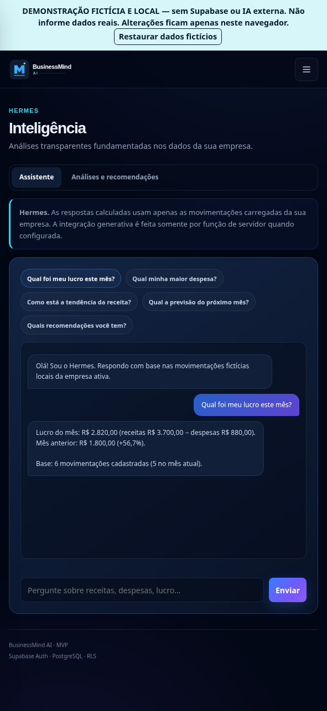
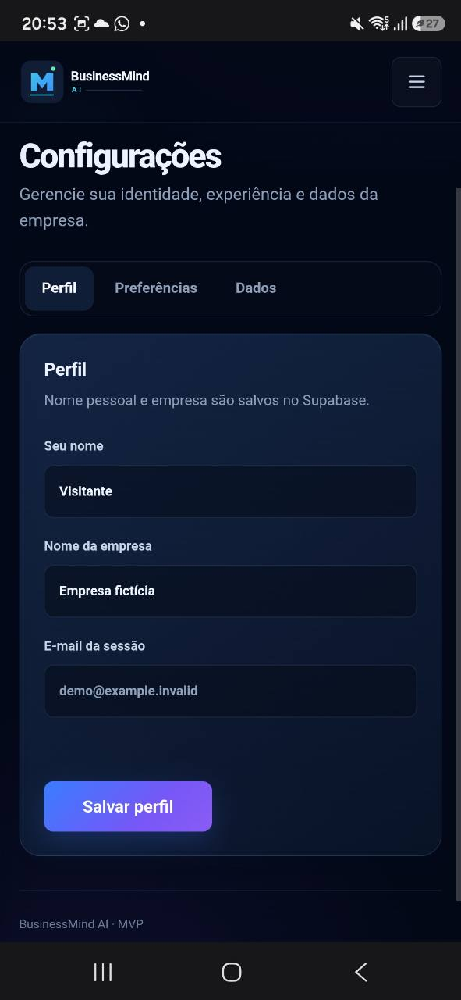

# BusinessMind AI

**MVP de gestão e análise financeira para pequenos negócios**, desenvolvido como projeto de portfólio para demonstrar desenvolvimento web, modelagem de dados, segurança e testes.

O sistema permite registrar receitas e despesas, visualizar indicadores financeiros e consultar o **Hermes**, assistente de análises determinísticas. É um MVP técnico, não um produto comercial validado.

## Experimente o projeto

**[Abrir demonstração pública — sem cadastro](https://businessmind-ai-demo.guisoster060.workers.dev)**

A demonstração utiliza dados fictícios armazenados no navegador. Permite navegar pelas quatro telas, registrar movimentações ilustrativas e experimentar o Hermes determinístico. **Não utiliza autenticação, banco remoto ou IA generativa.**

**[Abrir ambiente de testes com Supabase](https://businessmind-ai-staging.pages.dev)**

O staging utiliza autenticação e dados persistidos no PostgreSQL, com acesso controlado. Exige conta autorizada e deve receber **somente dados fictícios**. É um ambiente experimental, não uma aplicação de produção destinada a usuários finais.

## Interface

| Visão geral | Indicadores |
| --- | --- |
|  |  |
| Inteligência | Configurações |
|  |  |

*Capturas da demonstração com dados fictícios; não comprovam integração remota.*

## Funcionalidades e tecnologias

- **Frontend:** HTML semântico, CSS, JavaScript e SVG; navegação responsiva.
- **Dados:** receitas e despesas, indicadores, séries mensais, categorias e exportação CSV.
- **Backend do staging:** Supabase Auth, PostgreSQL, Row Level Security (RLS) e Edge Functions.
- **Hermes:** análises determinísticas com limites explícitos quando faltam dados.
- **Qualidade:** testes automatizados em Node.js e Deno, verificações de segurança e GitHub Actions.

## Para quem está avaliando

1. Abra a **demonstração pública** acima para conhecer a experiência sem criar conta.
2. Registre uma movimentação fictícia em **Indicadores** e confira o resultado em **Visão geral**.
3. Abra **Inteligência** e faça uma pergunta ao Hermes.
4. Consulte o [código da aplicação](projects/businessmind-ai/app), o [README técnico](projects/businessmind-ai/README.md), o [roteiro de avaliação](projects/businessmind-ai/docs/REVIEW_GUIDE.md) e os [testes](projects/businessmind-ai/tests).

## Estado de validação — 12/11/2026

O staging foi publicado com sucesso no Cloudflare Pages. Em teste manual no Android, o Hermes consultou a Edge Function (HTTP 200) e exibiu análise determinística sobre movimentações fictícias. A autorização de teste único do Gemini foi consumida, **mas uma resposta generativa do Gemini não foi confirmada**. Portanto, a integração Gemini é **experimental**, não uma funcionalidade validada. A validação completa em Windows e Safari/iOS também permanece pendente.

As alterações finais de interface, testes e documentação estão em [revisão no PR #26](https://github.com/guisoster060-cmyk/softplan-futures-ai-portfolio/pull/26), **ainda não integradas à branch principal**. O [relatório de entrega nessa revisão](https://github.com/guisoster060-cmyk/softplan-futures-ai-portfolio/blob/fix/businessmind-final-staging-20261112/projects/businessmind-ai/docs/DELIVERY_STATUS_2026-11-12.md) distingue evidências, limitações e próximas etapas.

## Executar localmente

```bash
cd projects/businessmind-ai
npm ci
python3 -m http.server 8080 --directory app
```

Abra `http://localhost:8080`. Para executar as verificações locais, use `npm run verify`. A configuração local pode exigir credenciais públicas de um projeto Supabase autorizado; **não adicione chaves administrativas ou de IA ao frontend**.

---

**Escopo:** MVP de portfólio. Não usar dados reais de clientes no ambiente de testes.
