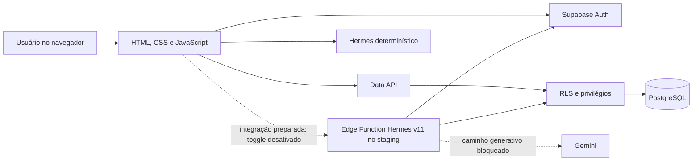

# Arquitetura do BusinessMind AI

## 1. Visão geral

O BusinessMind AI usa frontend estático e Supabase como backend gerenciado. Não existe servidor de aplicação próprio no fluxo ativo. Autenticação, PostgreSQL, API de dados e RLS são fornecidos pelo Supabase; o frontend é publicado no Cloudflare Pages.

## 2. Componentes

### Frontend

- `app/index.html`: estrutura das telas, autenticação, onboarding e sprite SVG.
- `app/style.css` e `app/charts.css`: design system, responsividade e gráficos.
- `app/app.js`: estado da sessão, acesso ao Supabase, navegação, CRUD e renderização.
- `app/domain.js`: validação, mapeamento e cálculos financeiros testáveis em Node.js.
- `app/config.js`: URL e publishable key públicas do Supabase. Não contém chave administrativa.

### Supabase

- Auth por e-mail e senha.
- PostgreSQL com `profiles`, `companies`, `company_members` e `transactions`.
- RPC `create_company` como única operação pública de criação de empresa.
- Triggers para criação de perfil, atualização de timestamp e limite de movimentações.
- RLS e grants por coluna como defesa em camadas.

### Hermes

- **Ativo:** regras determinísticas no navegador sobre dados já autorizados.
- **Implantado somente no staging:** Edge Function Hermes v11 com `verify_jwt=true`; valida JWT, confirma a associação em `company_members`, consulta `transactions` sob RLS e calcula agregados. `STAGING_DETERMINISTIC_ONLY=true` devolve a resposta determinística antes de `claim_hermes_test_once` e de qualquer fetch ao Gemini.
- **Desativado por padrão:** `hermesGenerativeEnabled` inicia como `false`; o servidor também exige `HERMES_DATA_SHARING_APPROVED=true`, empresa na allowlist `HERMES_APPROVED_COMPANY_IDS` e `GEMINI_API_KEY`.
- **Fallback:** ausência de configuração, falha, resposta inválida ou timeout retorna ao motor determinístico.

### Entrega

- Git e GitHub para versionamento e revisão.
- GitHub Actions para sintaxe, testes e documentação.
- Cloudflare Pages para previews do frontend estático.

## 3. Fluxos de dados

### Autenticação e onboarding

1. Usuário envia credenciais ao Supabase Auth.
2. O trigger `handle_new_user` cria `profiles` no cadastro.
3. O frontend consulta a associação em `company_members`.
4. Sem associação, exibe onboarding e chama `create_company`.
5. A função cria empresa e vínculo de proprietário na mesma operação.

### Movimentações

1. Frontend valida o formulário com `domain.validateTransaction`.
2. `supabase-js` envia a operação com o JWT da sessão.
3. Grants limitam as colunas disponíveis.
4. RLS verifica a associação do usuário à empresa.
5. PostgreSQL aplica constraints, defaults e triggers.
6. A interface usa a linha retornada para atualizar o estado.

### Indicadores

As linhas autorizadas são carregadas e convertidas para o modelo da interface. Totais, margem, variações, categorias, alertas e projeção simples são calculados em memória. Nenhum KPI é armazenado no banco e nenhum valor fictício é injetado no dashboard autenticado.

### Pergunta à Edge Function Hermes e caminho generativo bloqueado

1. O navegador envia pergunta e empresa selecionada com o JWT da sessão.
2. A função valida formato, origem, JWT e limite básico por usuário.
3. O `company_id` recebido não é confiado: a função exige uma linha autorizada em `company_members` para o usuário autenticado.
4. A consulta a `transactions` usa publishable key + JWT e permanece sujeita à RLS.
5. A função pagina `transactions` sob RLS com contagem exata e falha fechada se alguma página estiver incompleta. Código determinístico valida cada registro e soma em centavos inteiros.
6. Após validar JWT, associação à empresa, escopo da pergunta e completude dos dados financeiros, o staging v11 retorna obrigatoriamente a resposta determinística. Esse retorno ocorre antes da avaliação dos controles específicos do caminho generativo, da RPC de uso único e do fetch ao Gemini. Nenhum agregado é enviado ao provedor nesse caminho.
7. O caminho generativo permanece apenas preparado no código: se futuramente autorizado e desbloqueado, exige aprovação global e por empresa, reivindicação única para o teste controlado e base suficiente. Enviaria intenção analítica derivada e agregados mensais, nunca pergunta livre, descrições, categorias identificáveis ou IDs. A allowlist manual não substitui consentimento auditável.
8. A interface prevê separar “dados calculados pelo sistema” de “interpretação gerada pelo Gemini”; essa interpretação não é uma capacidade validada do staging atual.

## 4. Modelo de dados

| Tabela | Responsabilidade | Relações principais |
| --- | --- | --- |
| `profiles` | Nome exibido do usuário. | PK e FK para `auth.users.id`. |
| `companies` | Unidade de isolamento empresarial. | `owner_id` referencia `auth.users`. |
| `company_members` | Associação usuário–empresa e papel. | PK composta por `company_id` e `user_id`. |
| `transactions` | Receitas e despesas. | Pertence a `companies`; `created_by` referencia `auth.users`. |

## 5. Controles de segurança

- Publishable key no cliente; chaves privadas proibidas no frontend.
- JWT do usuário propagado pelo SDK.
- RLS habilitado nas quatro tabelas.
- Funções `is_company_member` e `is_company_owner` com `search_path` vazio.
- RPC autenticada para criação atômica de empresa e vínculo.
- `created_by` preenchido por `auth.uid()` e não enviado pelo frontend.
- Constraints para tipos, comprimentos e valores.
- Neutralização de fórmulas no CSV.
- Segredo do provedor de IA previsto apenas no ambiente da Edge Function.
- CORS por allowlist, `Cache-Control: no-store`, prazo total de 20 segundos, até 12 segundos no provedor, limites de corpo e resposta e `redirect: 'error'`.
- Nenhum log explícito de perguntas, respostas ou valores financeiros.
- Proteção básica de 10 requisições por usuário/minuto por instância.

## 6. Limitações arquiteturais

- `app.js` acumula acesso a dados, estado e renderização; uma separação em módulos é evolução recomendada.
- A seleção multiempresa existe; consentimento para IA ainda não tem fluxo de opt-in/retirada persistido no banco.
- Não existe cache offline ou fila de sincronização; leituras paginadas não formam snapshot transacional.
- Não existe monitoramento centralizado de erros.
- A Edge Function v11 foi implantada e o Hermes determinístico validado manualmente no staging; o caminho generativo não foi validado remotamente nem implantado em produção.
- O rate limit em memória não é global entre instâncias e precisa de solução distribuída antes de escala/produção.
- No tier gratuito do Gemini, dados submetidos podem ser usados para melhoria de produtos conforme os termos oficiais; o envio real permanece bloqueado até aprovação explícita.

## 7. Documentos relacionados

- [REQUIREMENTS.md](REQUIREMENTS.md)
- [TECHNICAL_DECISIONS.md](TECHNICAL_DECISIONS.md)
- [TESTING.md](TESTING.md)
- [DESIGN_SYSTEM_V0.5.md](DESIGN_SYSTEM_V0.5.md)
