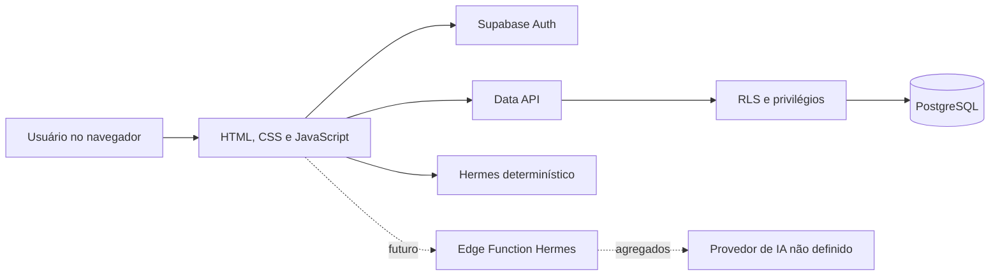

# Arquitetura do BusinessMind AI

## 1. Visão geral

O BusinessMind AI usa frontend estático e Supabase como backend gerenciado. Não existe servidor de aplicação próprio no fluxo ativo. Autenticação, PostgreSQL, API de dados e RLS são fornecidos pelo Supabase; o frontend é publicado no Cloudflare Pages.

## 2. Componentes

### Frontend

- `app/index.html`: estrutura das telas, autenticação, onboarding e sprite SVG.
- `app/style.css` e `app/charts.css`: design system, responsividade e gráficos.
- `app/app.js`: estado da sessão, acesso ao Supabase, navegação, CRUD e renderização.
- `app/domain.js`: validação, mapeamento e cálculos financeiros testáveis em Node.js.
- `app/config.js`: URL e publishable key públicas do Supabase. Não contém chave administrativa.

### Supabase

- Auth por e-mail e senha.
- PostgreSQL com `profiles`, `companies`, `company_members` e `transactions`.
- RPC `create_company` como única operação pública de criação de empresa.
- Triggers para criação de perfil, atualização de timestamp e limite de movimentações.
- RLS e grants por coluna como defesa em camadas.

### Hermes

- **Ativo:** regras determinísticas no navegador sobre dados já autorizados.
- **Preparado:** Edge Function que valida JWT, consulta `transactions` sob RLS, agrega valores e só então chama um provedor.
- **Não ativo:** provedor generativo, segredos e deploy da Edge Function.

### Entrega

- Git e GitHub para versionamento e revisão.
- GitHub Actions para sintaxe, testes e documentação.
- Cloudflare Pages para previews do frontend estático.

## 3. Fluxos de dados

### Autenticação e onboarding

1. Usuário envia credenciais ao Supabase Auth.
2. O trigger `handle_new_user` cria `profiles` no cadastro.
3. O frontend consulta a associação em `company_members`.
4. Sem associação, exibe onboarding e chama `create_company`.
5. A função cria empresa e vínculo de proprietário na mesma operação.

### Movimentações

1. Frontend valida o formulário com `domain.validateTransaction`.
2. `supabase-js` envia a operação com o JWT da sessão.
3. Grants limitam as colunas disponíveis.
4. RLS verifica a associação do usuário à empresa.
5. PostgreSQL aplica constraints, defaults e triggers.
6. A interface usa a linha retornada para atualizar o estado.

### Indicadores

As linhas autorizadas são carregadas e convertidas para o modelo da interface. Totais, margem, variações, categorias, alertas e projeção simples são calculados em memória. Nenhum KPI é armazenado no banco e nenhum valor fictício é injetado no dashboard autenticado.

## 4. Modelo de dados

| Tabela | Responsabilidade | Relações principais |
| --- | --- | --- |
| `profiles` | Nome exibido do usuário. | PK e FK para `auth.users.id`. |
| `companies` | Unidade de isolamento empresarial. | `owner_id` referencia `auth.users`. |
| `company_members` | Associação usuário–empresa e papel. | PK composta por `company_id` e `user_id`. |
| `transactions` | Receitas e despesas. | Pertence a `companies`; `created_by` referencia `auth.users`. |

## 5. Controles de segurança

- Publishable key no cliente; chaves privadas proibidas no frontend.
- JWT do usuário propagado pelo SDK.
- RLS habilitado nas quatro tabelas.
- Funções `is_company_member` e `is_company_owner` com `search_path` vazio.
- RPC autenticada para criação atômica de empresa e vínculo.
- `created_by` preenchido por `auth.uid()` e não enviado pelo frontend.
- Constraints para tipos, comprimentos e valores.
- Neutralização de fórmulas no CSV.
- Segredo do provedor de IA previsto apenas no ambiente da Edge Function.

## 6. Limitações arquiteturais

- `app.js` acumula acesso a dados, estado e renderização; uma separação em módulos é evolução recomendada.
- A seleção usa a primeira empresa associada; não há seletor multiempresa.
- Não existe cache offline, fila de sincronização ou paginação de movimentações.
- Não existe monitoramento centralizado de erros.
- A Edge Function Hermes não foi implantada nem testada ponta a ponta.

## 7. Documentos relacionados

- [REQUIREMENTS.md](REQUIREMENTS.md)
- [TECHNICAL_DECISIONS.md](TECHNICAL_DECISIONS.md)
- [TESTING.md](TESTING.md)
- [DESIGN_SYSTEM_V0.5.md](DESIGN_SYSTEM_V0.5.md)

