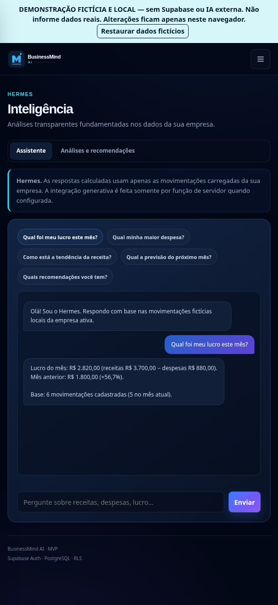
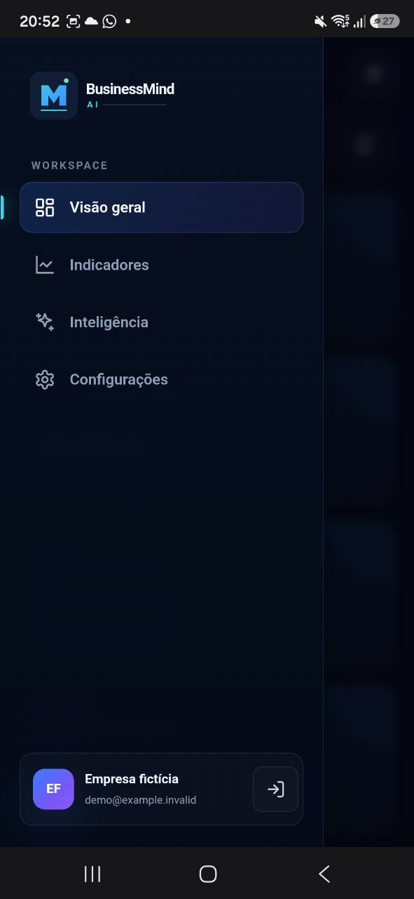
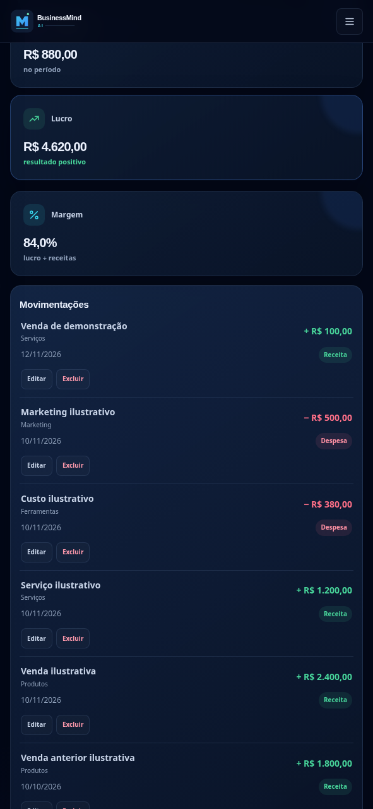

# Galeria visual — BusinessMind AI

As imagens abaixo estão **publicadas no repositório** e mostram a **demonstração com dados fictícios**, não a prévia autenticada com Gemini. Elas permitem conhecer o produto antes de criar uma conta.

| Tela | Imagem | O que avaliar |
|---|---|---|
| Visão geral |  | Cards de receitas, despesas, resultado e navegação |
| Indicadores |  | Indicadores e movimentações |
| Inteligência |  | Interface do Hermes (demo determinística) |
| Configurações |  | Preferências e dados demonstrativos |
| Navegação mobile |  | Menu em tela estreita |
| Indicadores em detalhe |  | Visualização detalhada |

**Acesso imediato:** [Abrir demo sem login](https://businessmind-ai-demo.guisoster060.workers.dev) · [Guia rápido](START_HERE_RECRUITER.md).

## Capturas reais da prévia autenticada

O responsável enviou cinco capturas adicionais de Visão geral, menu, Indicadores, Inteligência e Configurações. Foram preparadas versões PNG com dados de identificação ocultados, mas **não foram enviadas ao GitHub por esta integração**, que não oferece escrita binária. Não apresentar a galeria acima como prova visual da prévia Gemini.

**Para completar a publicação:** extrair o ZIP de capturas fornecido na conversa e enviar os cinco PNGs à pasta `projects/businessmind-ai/screenshots/staging-recruiter/` pela interface do GitHub. Em seguida, adicionar links nessa seção. Não enviar JPGs originais com e-mails.
